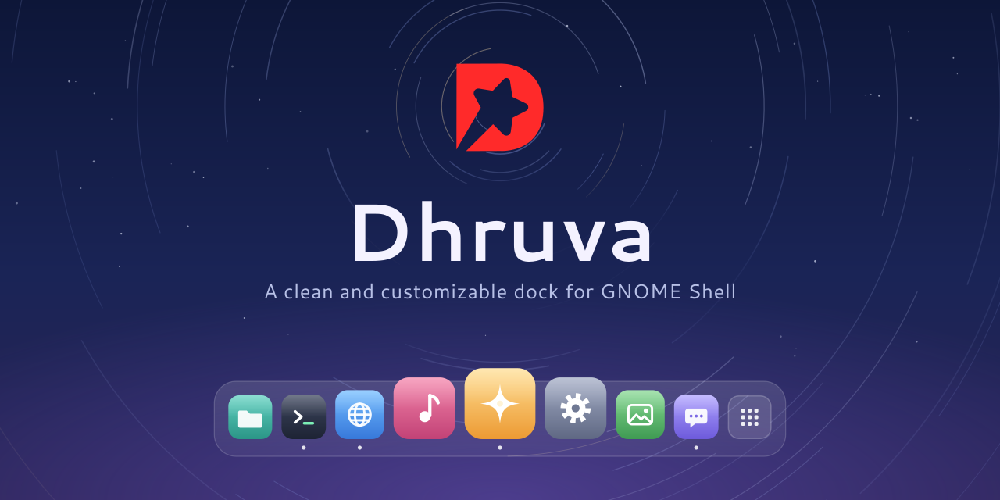
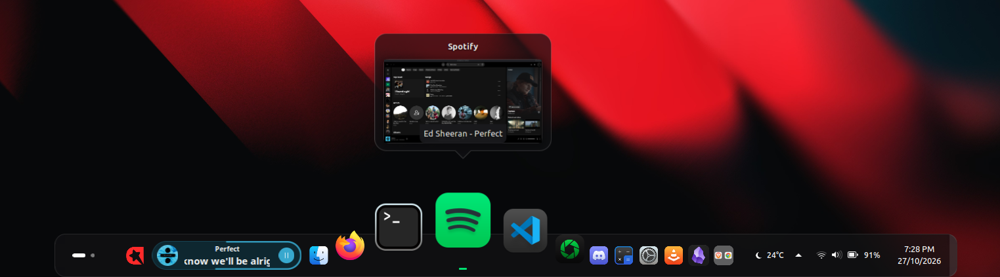
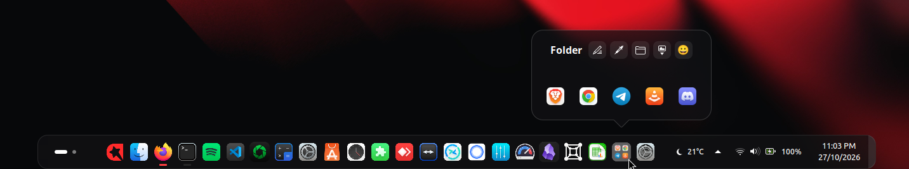

<div align="center">



<br>

<a href="https://extensions.gnome.org/extension/9495/dhruva/"></a>
<a href="https://github.com/narkagni/dhruva/releases"></a>
<a href="https://extensions.gnome.org/extension/9495/dhruva/"></a>
<a href="LICENSE"></a>

<p>
<a href="https://extensions.gnome.org/extension/9495/dhruva/"><b>Install</b></a> &nbsp;·&nbsp;
<a href="#gallery"><b>Gallery</b></a> &nbsp;·&nbsp;
<a href="CHANGELOG.md"><b>Changelog</b></a> &nbsp;·&nbsp;
<a href="https://github.com/narkagni/dhruva/issues"><b>Report an issue</b></a> &nbsp;·&nbsp;
<a href="#support-dhruva"><b>Support</b></a>
</p>

</div>

Dhruva is a dock for GNOME Shell that you can shape the way you like. Keep it as a floating dock, stretch it edge to edge, or turn it into a full panel that holds your workspaces, tray, Quick Settings and clock, all in one bar.

<br>

## Features

<details>
<summary><b>Dock and layout</b></summary>
<br>

- Place it on any edge of the screen, on one monitor or on all of them.
- Floating dock, full width bar, or an independent dock with its own pinned apps and app grid.
- Themes, gradients, borders, and a Wallpaper Color theme that follows your light or dark style.
- Real blur behind the dock and its popups, without banding on dark wallpapers.
- Running indicators as dots, lines or Windows-style bars, with an optional coloured box behind running apps.

</details>

<details>
<summary><b>Panel mode</b></summary>
<br>

- Turns the dock into a panel that replaces the GNOME top bar.
- Workspace indicator, Quick Settings, date and tray applets live right in the bar.
- Dynamic Panel shrinks to fit its content and can sit at the start, centre or end of the edge.
- Apps that don't fit move into an overflow menu instead of squeezing the bar.
- Rearrange tray applets with <kbd>Ctrl</kbd> + drag, and choose how the date is written.
- Hover zoom works here too, and the Dynamic Panel grows with the zoom.

</details>

<details>
<summary><b>Hover zoom</b></summary>
<br>

- Six motions: Fluid, Domino, Cylinder, Magnetic, Jelly and Coverflow.
- Set the zoom, spread, lift and smoothness, and let neighbours slide apart to make room.
- Tooltips and window previews follow the zoomed icon.

</details>

<details>
<summary><b>Window previews</b></summary>
<br>

- Live thumbnails of an app's windows when you hover its icon.
- Peek fades the other windows so you can see the one you're pointing at.
- A large preview for a closer look before you switch.

</details>

<details>
<summary><b>Folders</b></summary>
<br>

- Group apps by dragging one onto another with <kbd>Ctrl</kbd> held.
- Name folders and give them an emoji or your own image as an icon.

</details>

<details>
<summary><b>Music Pill</b></summary>
<br>

- Shows the song that's playing right in the dock, with its album art.
- Synced lyrics, fetched from <a href="https://lrclib.net">LRCLIB</a>.
- A player popup with a seek bar, shuffle and repeat, coloured from the album art.
- Choose what a click, middle click, right click or double click does.

</details>

<details>
<summary><b>Auto-hide</b></summary>
<br>

- Smart, Dodge Windows, Maximized, Always or Never.
- Leave a small strip of the dock on screen when it hides.
- Choose what happens over fullscreen apps and games: stay hidden, need a longer push, or show as usual.
- Apps that hide the pointer, like most games and video players, never bring the dock up by accident.

</details>

<details>
<summary><b>Animations</b></summary>
<br>

- More than 20 click effects, from Bounce and Jelly to a 3D coin spin.
- Minimize effects: Magic Lamp, Snake, Vortex, Origami and Jelly.
- Icons slide into place when apps open and close.

</details>

<details>
<summary><b>Modules and shortcuts</b></summary>
<br>

- App Grid button, clock, Recycle Bin, Show Desktop, Home and other folders, and mounted drives.
- <kbd>Super</kbd> + <kbd>1</kbd>–<kbd>9</kbd> opens the first nine apps on the dock.
- Scroll on the dock to switch workspaces, or on an icon to cycle through its windows.
- Open a new window with <kbd>Ctrl</kbd> + click or middle click.
- Drag apps from the app grid straight onto the dock.

</details>

<details>
<summary><b>Settings</b></summary>
<br>

- Search any setting from the top of the preferences window.
- Import and export your setup as a profile.
- Settings you never changed keep working the same way after an update.

</details>

<br>

## Gallery

<details open>
<summary><b>The dock</b></summary>
<br>

</details>

<details>
<summary><b>Hover zoom and minimize effects</b></summary>
<br>
<table>
<tr>
<td width="50%" align="center"><video src="https://github.com/user-attachments/assets/5c9d7773-230f-4ff6-a129-2656d7f2421d" controls width="800"></video><br><sub>Hover zoom</sub></td>
<td width="50%" align="center"><video src="https://github.com/user-attachments/assets/878602a3-e1d8-45a8-86a5-9d7dd5d33b0b" controls width="800"></video><br><sub>Genie</sub></td>
</tr>
</table>
</details>

<details>
<summary><b>Window previews and folders</b></summary>
<br>
<table>
<tr>
<td width="50%" align="center"><video src="https://github.com/user-attachments/assets/d0b40aaa-910a-452a-918d-431f92ed0f37" controls width="800"></video><br><sub>Peek</sub></td>
<td width="50%" align="center"><br><sub>App folders</sub></td>
</tr>
</table>
</details>

<br>

## Installation

### From extensions.gnome.org (recommended)

1. Open <a href="https://extensions.gnome.org/extension/9495/dhruva/"><b>Dhruva on extensions.gnome.org</b></a>.
2. Turn the switch on and confirm the install.

### Manual install

Use this to try the latest code from GitHub before it reaches extensions.gnome.org.

```bash
git clone https://github.com/narkagni/dhruva.git
cd dhruva
chmod +x manage.sh
./manage.sh install
```

Then restart GNOME Shell so it picks up the extension:

- **Wayland:** log out and log back in.
- **X11** (older GNOME versions only): press <kbd>Alt</kbd> + <kbd>F2</kbd>, type `r` and press <kbd>Enter</kbd>.

And enable it:

```bash
gnome-extensions enable dhruva@narkagni
```

<details>
<summary><b>Update a manual install</b></summary>
<br>

```bash
cd dhruva
git pull
./manage.sh install
```

Log out and back in afterwards so the new version loads.

</details>

<details>
<summary><b>Uninstall</b></summary>
<br>

```bash
gnome-extensions uninstall dhruva@narkagni
```

To also remove all of Dhruva's settings:

```bash
dconf reset -f /org/gnome/shell/extensions/dhruva/
```

</details>

<details>
<summary><b>Something not working?</b></summary>
<br>

- Turn off other dock extensions, like Ubuntu Dock or Dash to Dock. Two docks fight over the same space.
- Extensions that change the top bar clock or date can show a second clock in Panel mode.
- When you report an issue, include your GNOME Shell version (`gnome-shell --version`) and the log from the moment it happened:

```bash
journalctl -f -o cat /usr/bin/gnome-shell
```

</details>

<br>

## Support Dhruva

Dhruva is free and open source, and it's built and looked after by one person in their spare time. If it has made your desktop a nicer place, you can help keep it going:

<p align="center">
<a href="https://buymeacoffee.com/narkagni"></a>
</p>

<details>
<summary><b>Donate with crypto</b></summary>
<br>

| Coin | Address |
| --- | --- |
| Bitcoin (BTC) | `1GSHkxfhYjk1Qe4AQSHg3aRN2jg2GQWAcV` |
| Ethereum (ETH) | `0xf43c3f83e53495ea06676c0d9d4fc87ce627ffa3` |
| Tether (USDT, TRC20) | `THnqG9nchLgaf1LzGK3CqdmNpRxw59hs82` |

</details>

Not in a position to donate? That's completely fine. These help just as much:

- Star the repository so more people find it.
- Rate Dhruva on extensions.gnome.org.
- <a href="https://github.com/narkagni/dhruva/issues">Report bugs</a> with clear steps, or suggest features.
- Share a screenshot of your setup.

<br>

<div align="center">
<sub>Made by <a href="https://github.com/narkagni">NarkAgni</a> · Released under the <a href="LICENSE">GPL-3.0 license</a></sub>
</div>
